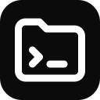
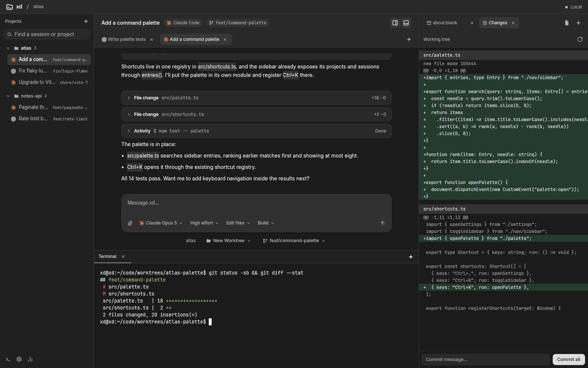
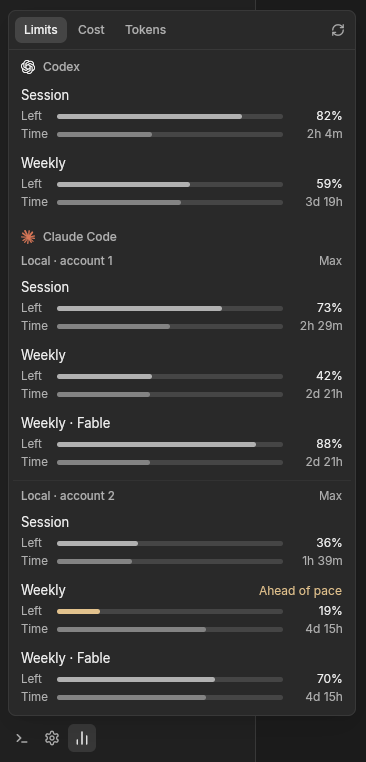
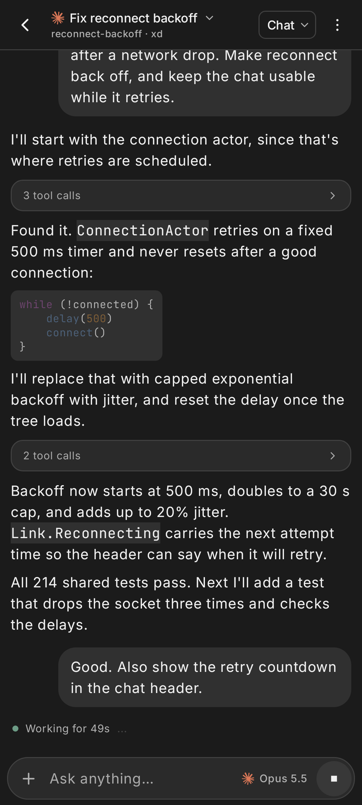

<p align="center">
  
</p>

<h1 align="center">xd</h1>

<p align="center">
  A local-first desktop workspace for user-installed Codex and Claude Code.
  <br>
  Run many agents across projects and worktrees, side by side with their diffs, terminals, and browser.
</p>

<p align="center">
  <a href="#install">Install</a> ·
  <a href="#features">Features</a> ·
  <a href="#documentation">Docs</a> ·
  <a href="https://github.com/RestartFU/xd/releases/latest">Latest release</a>
</p>

<p align="center">
  
</p>

xd doesn't ship a model or an agent. It wraps the CLIs, logins, and configuration
you already have in one persistent workspace. A single daemon owns every session,
so work keeps running when you close the window, and you can reach it from another
computer or your Android phone.

## Features

### Chat with your agents

- **Native chat** for Codex and Claude Code: streamed replies, activity cards for
  tool calls and shell runs, queued messages, and inline approvals and questions
  showing the command or diff they would apply.
- **Live subagent cards** show each delegated agent's model, current step, tools,
  tokens, and elapsed time, and keep its report once it finishes. Stop a Claude
  agent or send it to the background from its card.
- **Background work stays visible.** A chat whose agent still has background agents
  or shells running shows as waiting on them, with each task's latest output.
- **Attachments both ways.** Attach files with the paperclip, by dropping them, or
  by pasting an image. Images an agent names in a reply appear in the chat.

### Work side by side

- **Project → session → chat tabs.** A session works in the project's checkout
  or a checkout you pick, or in a new Git worktree on its own branch. Choose a new
  worktree to keep agents from editing the same files. A session's chat tabs share
  its workspace.
- **Side pane and terminal** next to every chat: an integrated browser, files, and
  changes on the side, a shell below, all resizable and remembered per chat.
- **Pull requests in place.** Projects, worktrees, and branches live in one
  sidebar, and a chat can link up to 32 pull requests: its branch's PR, ones
  opened from xd or by the agent, and any you add from the session header.
- **Settle finished sessions** with one click. Idle and merged sessions settle by
  themselves, even while the app is closed.

### Anywhere, on your terms

- **One persistent daemon** owns local and remote sessions; clients come and go.
- **Direct remote connections** over pinned TLS, with expiring pairing codes and
  revocable devices. No relay, no SSH.
- **An Android app** with the same projects, chats, approvals, terminal, and usage.
- **Usage and limits** (<kbd>Ctrl</kbd>+<kbd>U</kbd>): cost and tokens by provider,
  model, and day, plus your Codex and Claude subscription limits across accounts.
- **Uses your own tools.** xd discovers your installed CLIs and reuses their
  authentication and configuration. Dark and light themes included.

<table align="center">
  <tr>
    <td align="center"></td>
    <td align="center"></td>
  </tr>
  <tr>
    <td align="center"><sub>Subscription limits by account (<kbd>Ctrl</kbd>+<kbd>U</kbd>)</sub></td>
    <td align="center"><sub>A chat on Android</sub></td>
  </tr>
</table>

## Install

**Linux** (x86_64)

```sh
curl -fsSL https://github.com/RestartFU/xd/releases/latest/download/install.sh | sh -s -- --release
```

**macOS**

```sh
curl -fsSL https://github.com/RestartFU/xd/releases/latest/download/install-macos.sh | sh -s -- --release
```

**Windows** (x86_64): download `xd-windows-x86_64.zip` from the
[latest release](https://github.com/RestartFU/xd/releases/latest), extract the
whole archive, and run `xd.exe`.

The Linux and macOS installers need no root access. Nightly desktop builds are on
the [nightly release](https://github.com/RestartFU/xd/releases/tag/nightly), along
with the Android APK when signing credentials are configured.

<details>
<summary><b>Windows notes</b></summary>

The desktop and browser run natively; local projects and persistent sessions run in
your default WSL distribution. Install git, tmux, CA certificates, and your
assistant CLIs inside WSL first. The included README has setup instructions and a
WebView2 Runtime installer helper. Set `XD_WSL_DISTRIBUTION` to select another
distro.

</details>

## Getting started

1. **Install your assistants.** Install and sign in to Codex and/or Claude Code on
   the machine running the xd host, and keep their commands on `PATH`. Agent
   binaries and credentials are not included in xd.
2. **Add a project.** Press `+` beside **Projects** in the sidebar and choose a folder or repository.
3. **Start a session** in it and send a message. Open more chat tabs, the side
   pane, or the terminal as you go.
4. **Pair another device** (optional): open **Settings → Devices → Pair a device**
   on the host and copy the code. On the remote desktop or Android app, enter an
   address that reaches the host (LAN, Tailscale, or server; port 4001 by default)
   and paste the code. See [remote connections](docs/remote.md).

Installed Linux and macOS builds update themselves: an **Update** button appears
when a new xd, Codex, or Claude Code release is out, and nothing installs until you
confirm.

## Documentation

| Guide | What it covers |
| --- | --- |
| [Sessions and layout](docs/sessions.md) | Side pane and terminal, settling, auto-settle, and auto-delete |
| [The host](docs/host.md) | Assistant discovery, updates, resuming cut-off turns, memory limits |
| [Remote connections](docs/remote.md) | Pairing devices, switching hosts, shared sessions, device management |
| [Mobile development](docs/mobile.md) | The Android client and how it talks to the daemon |
| [Protocol](docs/protocol.md) | The client–daemon wire protocol |

## Build from source

```sh
./scripts/build.sh
./scripts/test.sh
```

Windows builds use `scripts/build-windows.ps1` with a matching static Linux host
from `scripts/build-windows-host.sh`. The `windows` GitHub Actions workflow builds
and checks both parts, including a real Windows-to-WSL connection.

## Acknowledgements

The CLI discovery and update behavior adapt portions of
[T3 Code](https://github.com/pingdotgg/t3code) for xd's Rust backend. Its MIT
notice is included in `data/licenses/t3code-LICENSE` and packaged builds.
