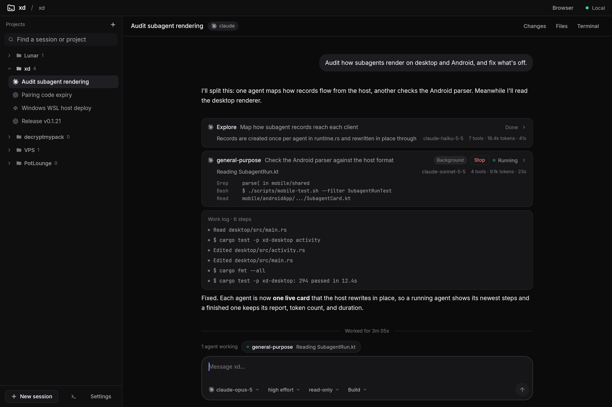
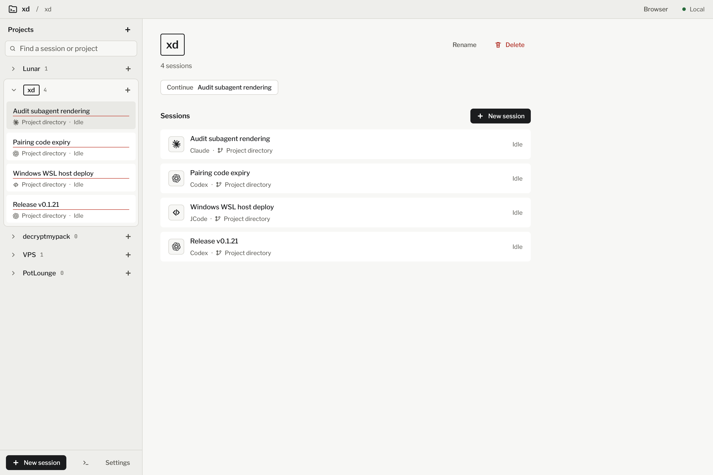
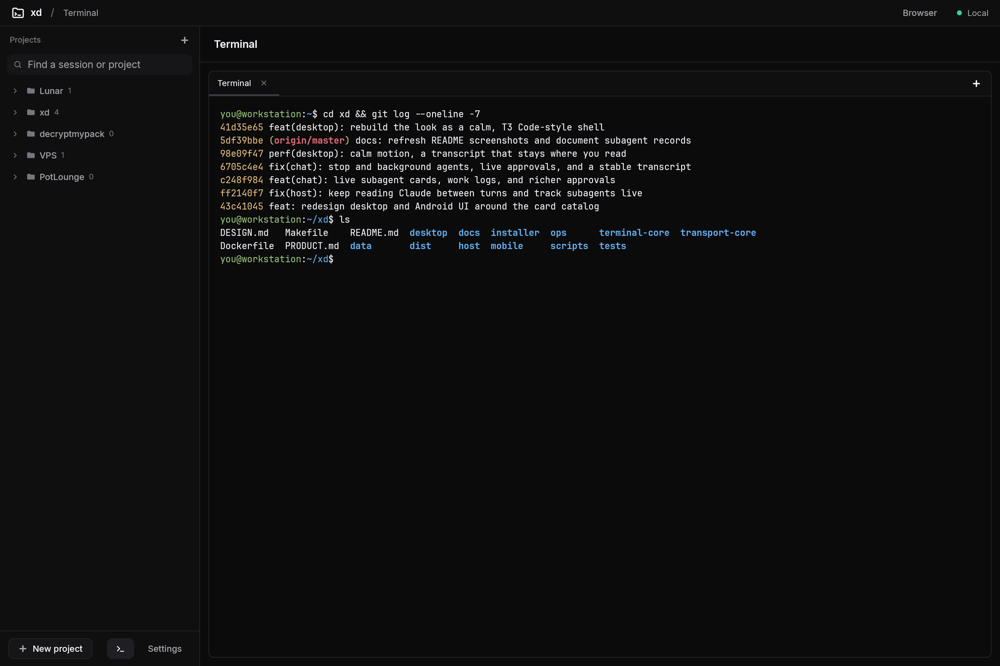

# xd

A local-first desktop workspace for user-installed Codex, Claude Code, and JCode.



<table>
  <tr>
    <td></td>
    <td></td>
  </tr>
</table>


## Highlights

- Native chat for Codex, Claude Code, and JCode, with streamed replies, activity cards, queues, and optional shell panes.
- Live subagent cards: each delegated agent shows its model, current step, tools, tokens, and elapsed time, and keeps its task, steps, and report once it finishes. Claude agents can be stopped or sent to the background from the card.
- Tool approvals and questions inline in the chat, with the command or diff they would apply, on desktop and Android.
- One persistent daemon owns local and remote sessions; work continues when clients disconnect.
- Direct remote connections over pinned TLS, with expiring pairing codes and revocable devices.
- Projects, Git worktrees, branches, and pull requests in one workspace.
- An integrated browser with separate tabs for each chat and shared site data.
- Uses your installed CLI tools, authentication, and configuration.
- Dark and light themes, chosen in Settings.

Each chat remembers its browser pages and whether the side pane is open. The
session header has two layout controls: side pane and bottom terminal. The side
pane starts with a browser page; use its `+` menu to add another page, Files, or
Changes. The bottom control opens a shell terminal below the chat. Both panes
can stay open together, and hiding them keeps their content. Hover over either
layout icon to see its label.

## Install

Linux x86_64:

```sh
curl -fsSL https://github.com/RestartFU/xd/releases/latest/download/install.sh | sh -s -- --release
```

macOS:

```sh
curl -fsSL https://github.com/RestartFU/xd/releases/latest/download/install-macos.sh | sh -s -- --release
```

Windows x86_64: download `xd-windows-x86_64.zip` from the
[latest release](https://github.com/RestartFU/xd/releases/latest), extract the
whole archive, and run `xd.exe`. The desktop and browser run natively;
local projects and persistent sessions run in your default WSL distribution.
Install git, tmux, CA certificates, and your assistant CLIs
inside WSL first. The included README has setup instructions and a WebView2
Runtime installer helper. Set `XD_WSL_DISTRIBUTION` to select another distro.

Nightly desktop builds are available from the [nightly release](https://github.com/RestartFU/xd/releases/tag/nightly). The Android APK is included when signing credentials are configured.
The Linux and macOS installers need no root access. Install the assistants you use separately and keep their commands on `PATH`.

## Installed assistants and updates

Install and sign in to your assistant CLI on the machine running the xd host.
xd discovers tools through your login shell and reuses their existing configuration
and login state. For remote sessions, the CLI and login belong on the remote
machine. Settings → **Assistant accounts** refreshes the CLI's current status.
Agent binaries and separate copies of their credentials are not included in xd.

Installed Linux and macOS builds check their own release channel for app updates
shortly after startup and every four minutes. Open **Settings → Updates** to check
manually, install an available update, and restart xd. Restart is blocked while
chats are running or terminal tabs are open; close the terminal tabs first.
Stored conversations can resume afterward. Updates always target
the local app, including while you are viewing a remote workspace. Source builds
and Windows installations require a manual update. Set `XD_DISABLE_AUTO_UPDATE=1`
to disable background checks.

The CLI discovery and update behavior adapt portions of
[T3 Code](https://github.com/pingdotgg/t3code) for xd's Rust backend.
Its MIT notice is included in `data/licenses/t3code-LICENSE` and packaged builds.

## Build

```sh
./scripts/build.sh
./scripts/test.sh
```

See [mobile development](docs/mobile.md) and [remote usage](docs/remote.md) for details.

Windows builds use `scripts/build-windows.ps1` with a matching static Linux host
from `scripts/build-windows-host.sh`. The `windows` GitHub Actions workflow
builds and checks both parts, including a real Windows-to-WSL connection.
